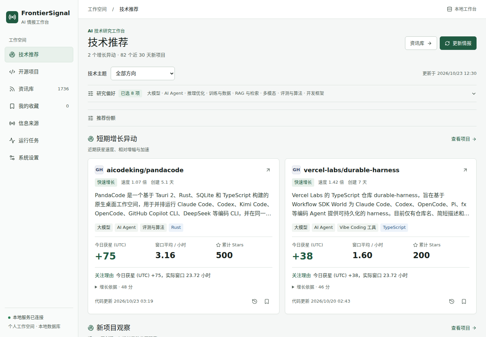
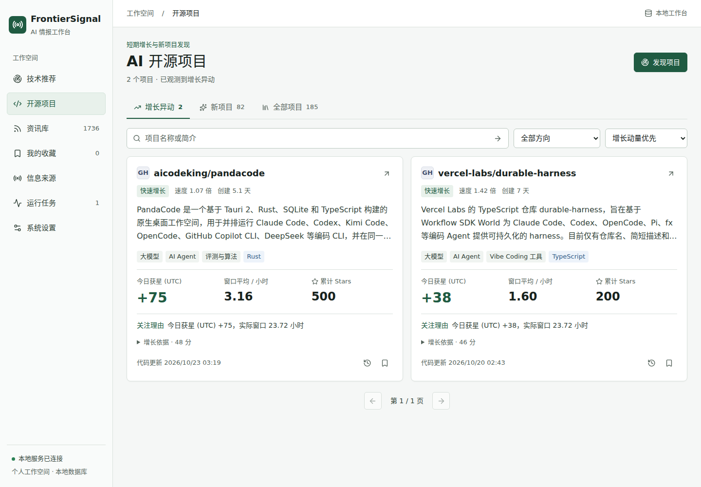
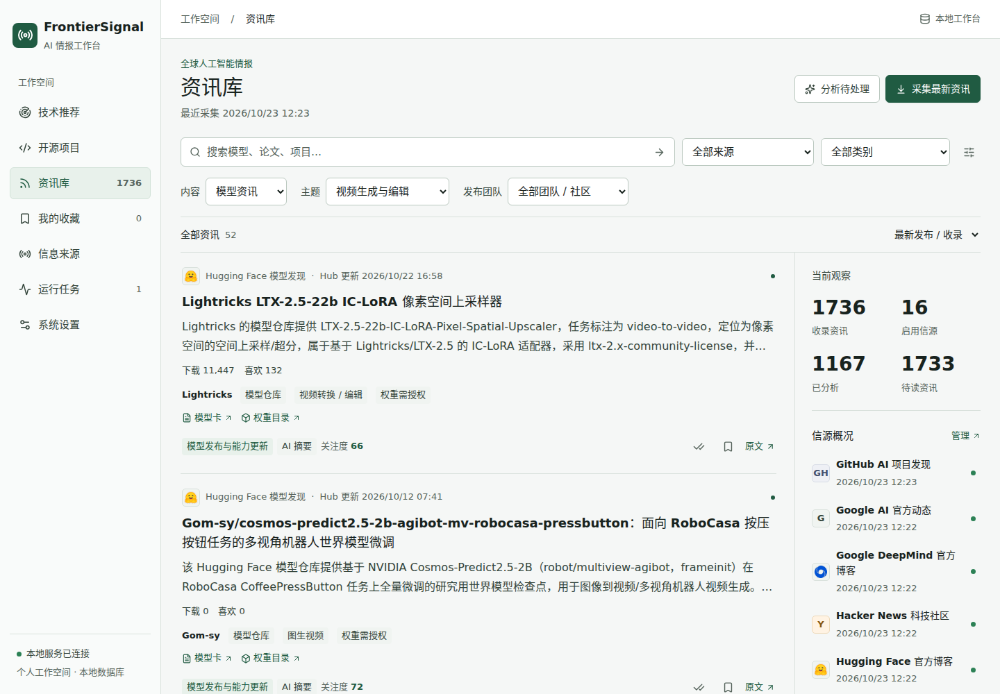
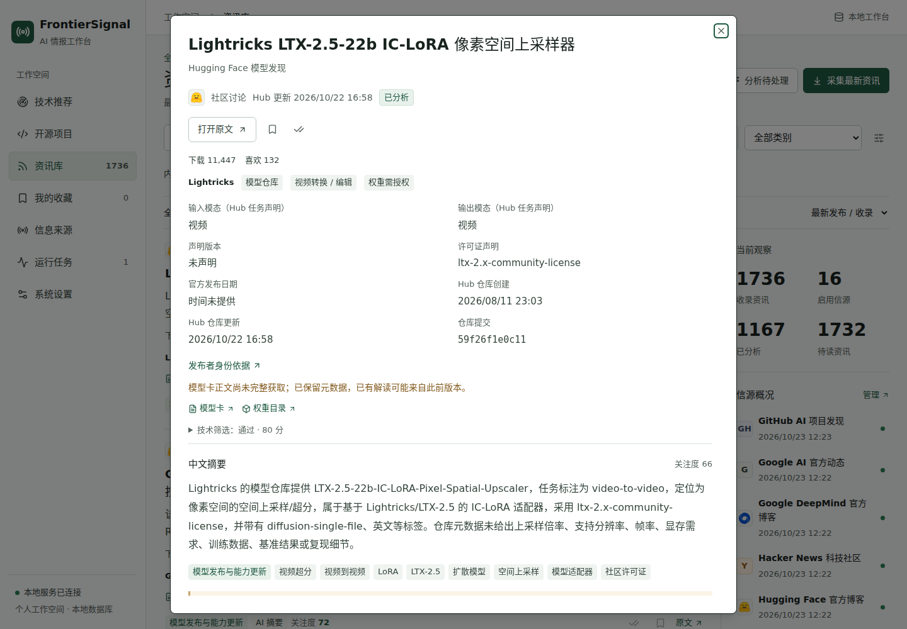
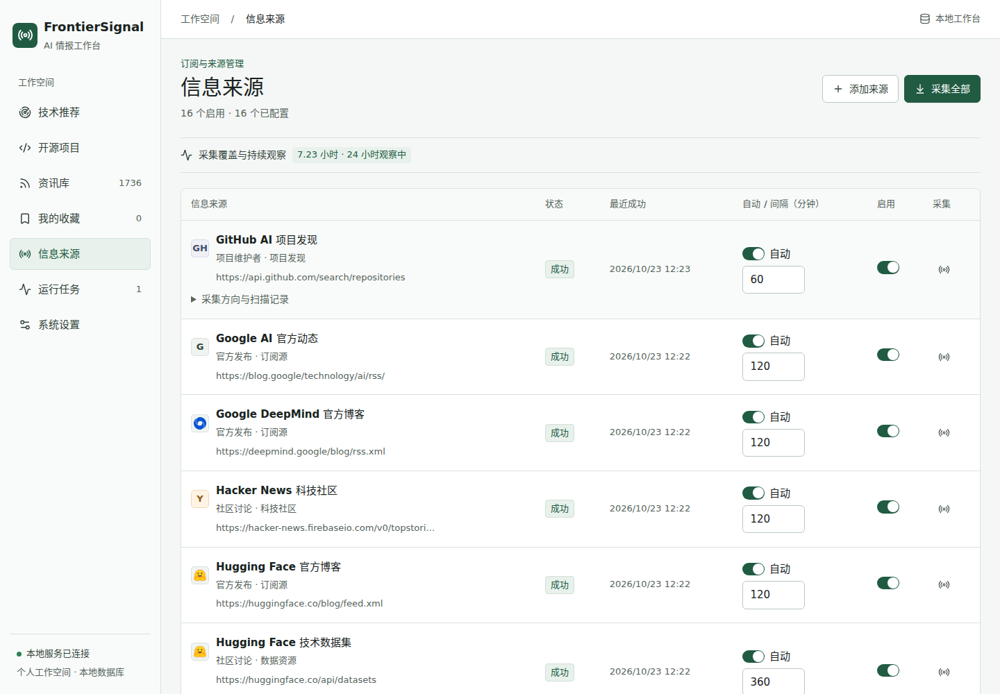

# FrontierSignal

[](https://github.com/yccc530/FrontierSignal/actions/workflows/ci.yml)

**面向个人技术研究者的 AI 技术情报工作台。**

持续发现短期 Stars 增长显著的开源项目，跟踪模型发布、前沿论文与开发工具，在本地工作台中完成中文阅读、检索、收藏和来源追踪。

[界面预览](#界面预览) · [快速开始](#快速开始) · [使用指南](docs/usage.md) · [模型与配置](docs/configuration.md) · [信息来源](docs/data-sources.md) · [常见问题](docs/troubleshooting.md)

## 界面预览

以下为 2026-10-23 从实际运行的工作台截取的桌面界面，分辨率为 1440 × 1000。内容与指标来自当时的本地采集数据，新安装不会附带这些资讯。点击图片可查看原尺寸。

**技术推荐**：集中浏览短期增长异动，查看中文简介、近期获星与推荐理由。

[](docs/images/workbench.png)

<details>
<summary>展开查看开源项目、模型资讯、详情阅读与来源管理</summary>

### 开源项目

切换增长异动、新项目与全部项目，按技术方向检索，区分近期获星和累计 Stars。

[](docs/images/projects.png)

### 模型资讯

按内容类型、技术主题和发布团队筛选。下图展示视频模型的中文解读、任务类型与原始资源链接。

[](docs/images/models.png)

### 详情阅读

查看中文摘要、输入输出模态、许可证声明和来源时间。缺少的发布日期、未完整获取的模型卡会明确标注。

[](docs/images/model-detail.png)

### 来源管理

管理来源启停、自动采集与间隔，查看最近成功时间、扫描记录和持续观察状态。

[](docs/images/sources.png)

</details>

## 你可以用它做什么

| 场景               | 工作台提供的能力                                                                 |
| ------------------ | -------------------------------------------------------------------------------- |
| 发现正在起量的项目 | 按短期获星、净增速度和加速情况发现项目，区分增长异动、新项目与完整项目库         |
| 追踪模型与技术发布 | 聚合模型卡、官方博客和论文，覆盖语言、图像、视频、音频、3D、机器人等方向         |
| 阅读技术情报       | 使用可配置的模型服务生成中文标题、摘要、分类与重要性评分，保留英文原文和证据链接 |
| 建立个人研究资料库 | 搜索关键词，按来源、主题、类型、时间和处理状态筛选，管理收藏与已读状态           |
| 调整关注方向       | 独立设置采集范围、研究偏好、推荐栏目条数和方向份额                               |
| 了解系统在做什么   | 查看采集任务、失败原因、来源覆盖、Stars 历史及模型调用记录                       |

**不配置 LLM 也能使用采集、检索和阅读。** 配置模型服务后，才会生成中文解读；模型调用失败时保留原始内容，可单独重试。

## 信息从哪里来

内置 **16 个来源配置、30 个技术主题**，优先通过官方 API 和公开 RSS/Atom 获取内容。

| 来源         | 采集内容                                                               |
| ------------ | ---------------------------------------------------------------------- |
| GitHub       | AI 项目发现、Stars 变化、版本发布；保留 vLLM、LangChain 的固定版本跟踪 |
| Hacker News  | AI 技术帖子、points、评论总数及有限评论样本                            |
| arXiv        | `cs.AI`、`cs.LG`、`cs.CL`、`cs.CV`，以及工程和科学研究专项查询         |
| Hugging Face | 模型、数据集、模型卡和官方博客                                         |
| 官方技术博客 | OpenAI、Google DeepMind、Google AI、NVIDIA                             |

主题包括 LLM、Agent、训练与推理、RAG、多模态、代码模型、OCR、创作模型、3D/CAD、世界模型、具身智能、Vibe 开发、MCP/Skills、开发工具链，以及 AI 科学研究。

GitHub 热榜来自官方 API 和实际观测数据，不等同于 GitHub Trending。缺少历史快照时，增长显示为待积累；不会用累计 Stars 高的老项目填满增长榜。X、Reddit 当前不接入，Anthropic 尚未配置稳定的官方订阅入口。具体频率和限制见 [信息来源](docs/data-sources.md)。

## 快速开始

### 1. 准备环境

| 依赖          | 要求                                                                  |
| ------------- | --------------------------------------------------------------------- |
| Git           | 用于克隆和更新仓库                                                    |
| uv            | 安装 Python 依赖并管理项目环境；项目固定使用 Python 3.11              |
| Node.js / npm | Node.js 22.22.2 或更高的 22 系列版本，使用 npm 锁文件安装             |
| PostgreSQL    | 默认由 Docker Desktop / Docker Compose 提供 PostgreSQL 18 与 pgvector |
| 浏览器        | 电脑端浏览器，工作区宽度至少 1024px                                   |

Windows 用户可以选择 **WSL2** 或 **原生 PowerShell**，只需使用其中一条路径。完整运行验收是在 WSL2 的用户态 PostgreSQL 环境完成的；Docker Desktop 部署和 Windows 原生全流程尚未独立验收。安装工具、已有数据库和替代部署步骤见 [安装与启动](docs/installation.md)。

### 2. 克隆并启动

先启动 Docker Desktop；使用 WSL2 时，在 Docker Desktop 中开启对应发行版的 WSL 集成。

**WSL2 终端：**

```bash
cd ~
git clone https://github.com/yccc530/FrontierSignal.git
cd FrontierSignal
bash scripts/start.sh
```

**或 Windows PowerShell：**

```powershell
git clone https://github.com/yccc530/FrontierSignal.git
cd FrontierSignal
.\scripts\Start.ps1
```

启动脚本会安装锁定依赖、生成私有 `.env` 和随机数据库密码、启动数据库、执行迁移、构建前端并启动应用。已有 `.env` 会保留。首次运行需要下载依赖和数据库镜像。

浏览器打开 **http://localhost:8000**。终端保持运行，按 `Ctrl+C` 停止应用；数据库和历史资讯会保留。不要用 `docker compose down -v` 作为日常停止命令，它会删除数据库卷。

### 3. 完成第一次采集

1. 打开「信息来源」，确认需要的来源已启用，点击「采集全部」。
2. 在「运行任务」查看任务是否成功，以及新增、重复或失败数量。
3. 在「资讯库」阅读实际入库内容，点击标题查看详情或打开原始链接。
4. 返回「技术推荐」查看推荐；「开源项目」中的增长数据会随持续采集逐步积累。

新安装不会附带演示新闻。查询组分轮扫描，首次采集也不会立刻覆盖全部技术方向。首次使用、筛选和推荐设置的详细操作见 [使用指南](docs/usage.md)。

## 启用中文 AI 解读

在项目根目录的私有 `.env` 中填写以下三项，然后重启后端：

```dotenv
FS_LLM_BASE_URL=https://your-provider.example/v1
FS_LLM_API_KEY=replace_with_your_own_key
FS_LLM_MODEL=your-model-id
```

以上是占位示例，需要替换为你自己的服务配置。接口地址是 Chat Completions 的基础地址，不要包含 `/chat/completions`。

进入「系统设置」点击「验证接口」，到「运行任务」确认验证成功；随后可在「资讯库」点击「分析待处理」。默认开启调度时，模型配置完整后也会自动分批分析，并产生服务商用量。

支持可配置的 OpenAI 兼容 Chat Completions 服务，不要求使用某个指定厂商。不同网关的参数能力可能不同，JSON mode 默认关闭。密钥只从本地文件或环境变量读取，页面不显示完整密钥。OpenCode 网关导入、代理和调用预算见 [配置说明](docs/configuration.md)。

## 日常维护

| 需要做的事                         | 入口                                  |
| ---------------------------------- | ------------------------------------- |
| 再次启动、后台运行、更新版本       | [安装与启动](docs/installation.md)    |
| 修改来源、阅读模型卡、调整推荐     | [使用指南](docs/usage.md)             |
| 配置 LLM、GitHub Token、代理和预算 | [配置说明](docs/configuration.md)     |
| 备份数据库、恢复到新数据库         | [备份与恢复](docs/backup-recovery.md) |
| 处理空白页面、连接失败、采集限额   | [故障排查](docs/troubleshooting.md)   |

应用按个人本地使用设计，默认监听 `127.0.0.1`，没有远程账户认证。数据保存在本机 PostgreSQL；启用云端 LLM 时，待分析的标题和正文片段会发送给你配置的服务商。电脑休眠、关闭 WSL 或停止后端期间不会采集，不承诺补齐停机期间的全部资讯。

## 开发与项目文档

仓库已配置 [GitHub Actions 自动检查](https://github.com/yccc530/FrontierSignal/actions/workflows/ci.yml)：推送到 `main`、向 `main` 提交 PR 或手动运行时，自动执行 Ruff、后端单元测试、前端单元测试和生产构建。无需配置 Secrets，不调用付费模型或实时采集接口；使用方法见 [开发与测试](docs/testing.md#github-actions)。

后端采用 Python 3.11、FastAPI、SQLAlchemy、Alembic、APScheduler；数据库使用 PostgreSQL 和 pgvector。前端采用 React、TypeScript、Vite、Tailwind CSS、shadcn/ui 和 TanStack Query。应用使用模块化单体结构，采集任务在后台运行，默认单进程服务。

| 文档                                                      | 内容                                     |
| --------------------------------------------------------- | ---------------------------------------- |
| [架构说明](docs/architecture.md)                          | 模块边界、数据流和持久化设计             |
| [开发与测试](docs/testing.md)                             | 本地开发、必要检查和真实服务验证方法     |
| [历史验收记录](docs/validation-history.md)                | 带日期的测试结果、已验证环境和未完成验证 |
| [项目计划](PROJECT_PLAN.md)                               | 当前进度与后续工作                       |
| [主题扩展清单](docs/collection-expansion-plan.md)         | 各采集方向的实现与验收状态               |
| [复用评估](REUSE_ASSESSMENT.md)                           | 上游项目审计与复用取舍                   |
| [开发约束](AGENTS.md) / [视觉规范](docs/design-system.md) | 贡献代码和界面调整时遵循的约定           |
| [更新记录](CHANGELOG.md)                                  | 功能和文档变更                           |

提交问题时，请提供操作系统、启动方式、复现步骤及脱敏错误信息，使用仓库的 [Issues](https://github.com/yccc530/FrontierSignal/issues)。不要附上 `.env`、密钥或完整数据库备份。

## 许可与致谢

部分 RSS 解析和 SimHash 逻辑适配自 AI News Brief，部分界面组件来自 shadcn/ui。原始版权和许可见 [第三方声明](THIRD_PARTY_NOTICES.md) 与 [licenses](licenses)。

FrontierSignal 的项目代码与文档采用 [MIT 许可证](LICENSE)，允许使用、修改、分发和商用，使用或分发时须保留版权与许可声明；软件按原样提供，不附带担保。

第三方代码和依赖继续遵循各自许可证。采集的文章、论文、模型卡及发布者商标不因本项目采用 MIT 而改变其原有权利或授权条件。
